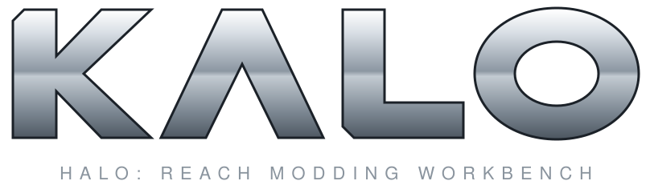
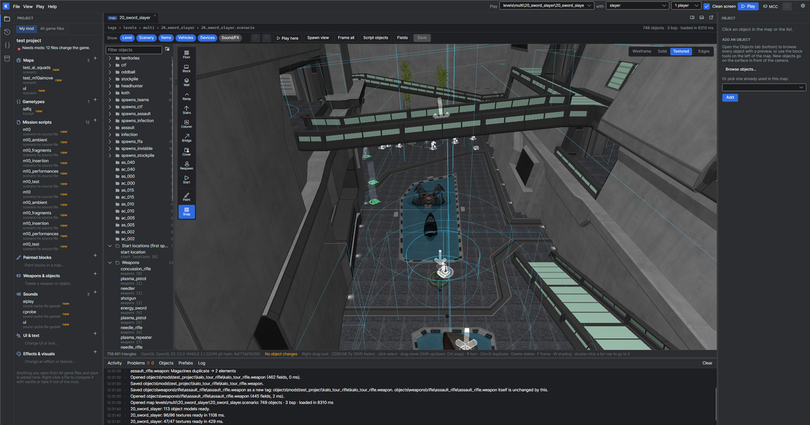
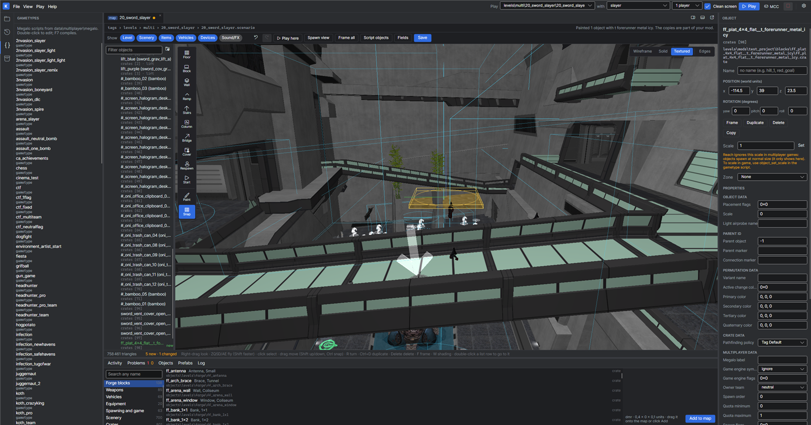
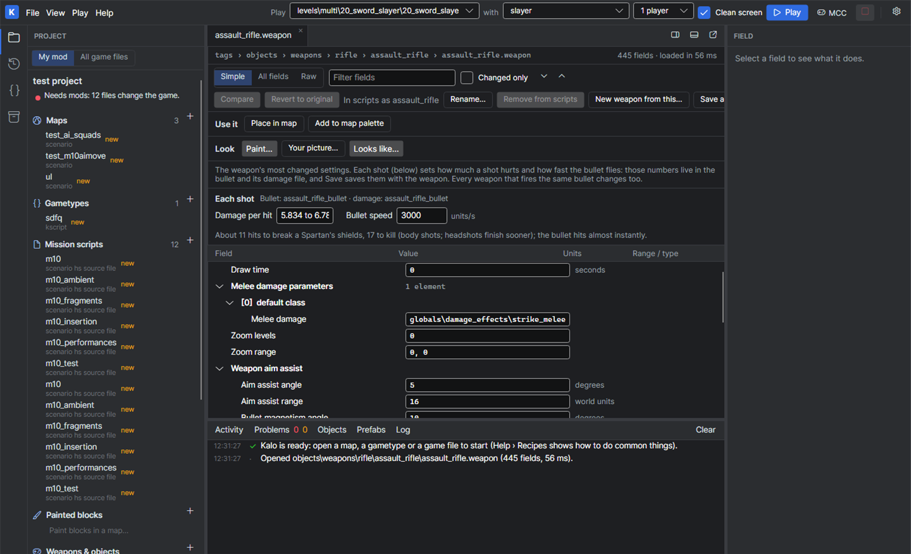
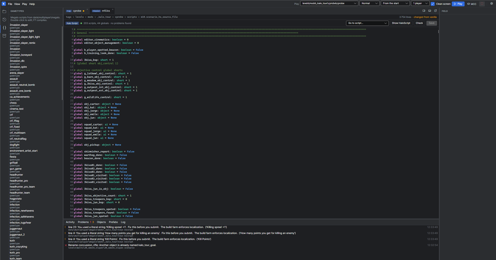

<p align="center">
  
</p>

> [!WARNING]
> **Kalo is very much a work in progress.** Things will break, change or be missing. Keep backups of anything you
> care about, and expect rough edges.

## Why Kalo

I wanted to mod Halo: Reach as a hobby. The existing tools work, but they are old and not very practical to use:
lots of separate programs, raw engine fields and command lines for things that should be a button. So I decided
to use [Claude](https://claude.ai) to build a tool for myself, one window that makes the common things easy.

## Features

- **A modern interface.** One window, a start page, readable labels instead of raw engine fields, search everywhere.
- **A 3D viewport.** Fly through any map, place and move objects, build with blocks, see the level textured.
- **Custom gametypes.** Write them in Kalo Script, a modern language for Reach's game modes, from templates such as
  Slayer, CTF, SWAT or Gun Game.
- **Campaign scripting.** Copy a mission and change its squads, triggers and cutscenes, with a script editor and a
  built-in reference.
- **Test in the game in seconds.** Play opens your map in the editing kit's test game, and saved changes reload live.
- **Safe for your game.** Your mods live in Kalo's own workspace: the game and the editing kit are never modified.

## Screenshots

**The map editor:** the level in 3D, its objects by folder, the building tools on the left.



**Building and painting:** Forge blocks from the palette, a painted floor selected, its properties on the right.



**A weapon, in plain words:** damage per hit, bullet speed and how many hits it takes to kill a Spartan.



**Campaign scripting:** a mission's script in Kalo Script, readable and checked for errors before you play.



## Requirements

- Windows 10 or 11, 64-bit
- [.NET 8 SDK](https://dotnet.microsoft.com/download/dotnet/8.0) (and the .NET Framework 4.8 developer pack, if the build asks for it)
- Halo: Reach Mod Tools (HREK) from Steam
- Halo: The Master Chief Collection, to play your mods in the real game

## Build and run

```powershell
git clone git@github.com:CharlyReux/Kalo.git
cd Kalo
dotnet build Kalo.sln -c Debug
src\Kalo.App\bin\Debug\net8.0\kalo.exe
```

Kalo looks for HREK in `D:\SteamLibrary\steamapps\common\HREK`. If yours is elsewhere, set the `KALO_HREK`
environment variable before building, for example `setx KALO_HREK "E:\SteamLibrary\steamapps\common\HREK"`
(then open a new terminal). The first start copies the kit's files into Kalo's workspace (`.kalo\`, several GB).

Then create a mod on the start page (a name is enough) and pick what to make. Help › Recipes walks through common
tasks step by step. More detail on every panel: [docs/DEVELOPMENT.md](docs/DEVELOPMENT.md).

## Credits

Halo and Halo: Reach are trademarks of Microsoft. Kalo is a fan-made tool, not affiliated with or endorsed by
Microsoft, 343 Industries, Halo Studios or Bungie. It needs your own copy of the editing kit and the game.
